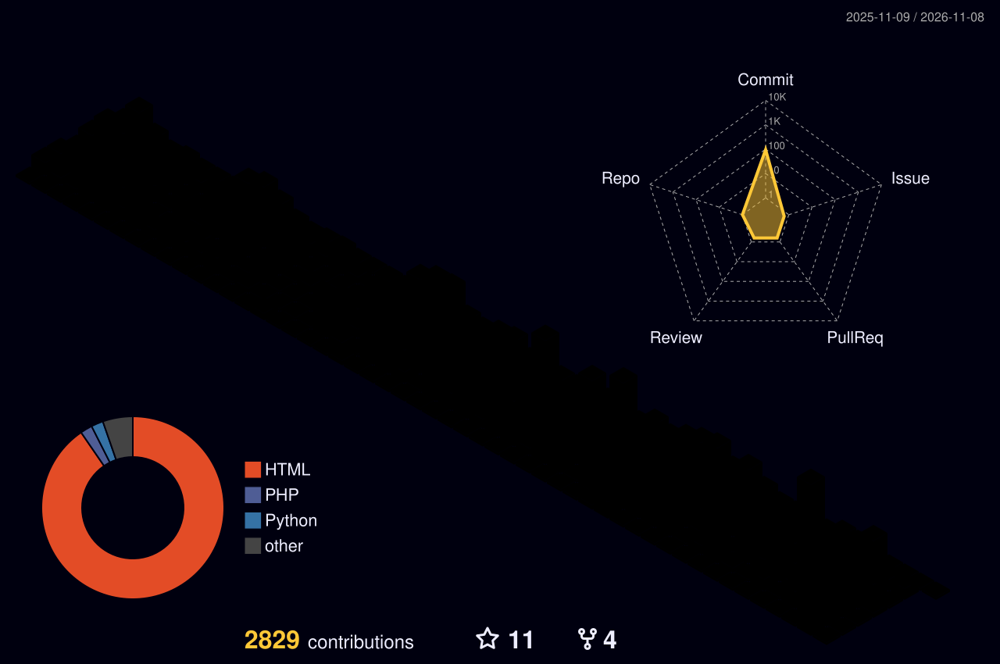

  

  

  
  
  
  

### 👋 About me

- 🏥 I build backend services for a **healthcare B2B data platform** at [ASUS AICS](https://aics.asus.com/home/): the data gateway, its shared data-contract schema, and the multi-tenant architecture.
- 🤖 I run a **Claude Code agent on Kubernetes** that picks up Jira tickets and ships them in parallel; it's now my team's default workflow.
- 🎓 Before that: NLP and traffic-forecasting research during my master's, **6 publications** (each walked through on my blog).
- ✍️ I write about algorithms, backend systems, and that research on [my blog](https://h30306.github.io/blog/).

### 🧰 Tech stack

   
   
  

Also: SQL Server, Oracle, SQLAlchemy, Hugging Face, Claude Code.

### 📈 Contributions

<picture>
  <source media="(prefers-color-scheme: dark)" srcset="profile-3d-contrib/profile-night-rainbow.svg" />
  <source media="(prefers-color-scheme: light)" srcset="profile-3d-contrib/profile-season.svg" />
  
</picture>

### ✍️ Latest from the blog

<!-- BLOG-POST-LIST:START -->
- [LeetCode 1011: Capacity To Ship Packages Within D Days](https://h30306.github.io/blog/leetcode/leetcode-1011/)
- [LeetCode 32: Longest Valid Parentheses](https://h30306.github.io/blog/leetcode/leetcode-32/)
- [LeetCode 452: Minimum Number of Arrows to Burst Balloons](https://h30306.github.io/blog/leetcode/leetcode-452/)
- [LeetCode 763: Partition Labels](https://h30306.github.io/blog/leetcode/leetcode-763/)
- [LeetCode 4097: Minimum Value of Merged Integers](https://h30306.github.io/blog/leetcode/leetcode-4097/)
<!-- BLOG-POST-LIST:END -->

<b>💼 Experience</b>

 

**Senior Software Engineer · [ASUS AICS](https://aics.asus.com/home/)** · Jan 2026 – Present
- Own the data gateway and shared data-contract schema for a healthcare B2B platform, deployed both on-prem and as a multi-tenant cloud service.
- Led the multi-tenant architecture: tenant-scoped connection pools, Redis and WebSocket isolation, and per-tenant log streams, so onboarding a tenant is a config change instead of a redeploy.
- Built a Claude Code-based agent on Kubernetes that picks up Jira tickets and implements them in parallel under git-worktree isolation; it is now the team's default workflow.

**Software Engineer · [ASUS AICS](https://aics.asus.com/home/)** · Dec 2022 – Dec 2025
- Shipped semver-gated releases of the shared data-contract schema to external vendors, with backward-compatible migrations so consumers upgrade on their own schedule.
- Cut API latency by replacing Starlette's `BaseHTTPMiddleware` with pure ASGI middleware and moving task handling onto a non-blocking queue.
- Served both SQL Server and Oracle sites from one codebase with a query generator built over the versioned schema spec.

**Research Assistant · [NLP Lab, Soochow University](https://nlp.bigdata.scu.edu.tw/)** · Jan 2020 – Jan 2022
- Built a dynamic MRT station embedding model to replace Node2Vec, lowering passenger-flow MAE from 1.47 to 0.93; published at IIAI-AAI 2021 and in *Knowledge-Based Systems*.
- Developed a hierarchical attention network that raised F1 from 0.58 to 0.86 on depression-signal detection in community posts.
- Designed entity-representation and density-estimation components for coreference resolution (master's thesis), improving F1 from 78.3 to 79.2.
- Built and tuned a multi-topic GPT-2 model, including handling of spelling errors.

**Data Analysis Intern · [Deloitte](https://www.deloitte.com/)** · Sep 2019 – Jun 2020
- Deployed an economic-indicator prediction model on Django and maintained the news and social-media crawlers and RPA jobs feeding it.
- Built an OCR pipeline for financial statements that reached 86% digit-recognition accuracy.

**Earlier**: automatic speech recognition intern at [Delta Electronics](https://www.deltaww.com/) (2019, noise-span detection with CNN + attention + LSTM) and research assistant at the Information Fusion Lab (2018–2019, micro-expression-based investor profiling; Honorable Mention at the HNCB Fintechers competition).

**Education**: M.S. in Data Science (2022, ranked 1st/18, Phi Tau Phi) and Bachelor of Big Data Management (2020), Soochow University.

<b>📑 Publications (7)</b>

 

Each paper has a walkthrough of the model on my blog.

| Year | Paper | Venue | Links |
|---|---|---|---|
| 2024 | Dynamic traffic network representation model for improving the prediction performance of passenger flow for mass rapid transit *Jheng-Long Wu, **Wei-Yi Chung**, Yu-Hsuan Wu, Yen-Nan Ho* | Knowledge-Based Systems | [Paper](https://doi.org/10.1016/j.knosys.2024.112442) · [Blog](https://h30306.github.io/blog/paper/2024-kbs-dynamic-traffic-network-representation/) |
| 2022 | Factor Detection Task of Cyberbullying Using the Deep Learning Model *Yu-Hsuan Wu, Sheng-Wei Huang, **Wei-Yi Chung**, Chen-Chia Yu, Jheng-Long Wu* | IEEE BigData 2022 Workshop | [Paper](https://doi.org/10.1109/BigData55660.2022.10020779) · [Slides](https://github.com/h30306/Factor-Detection-Task-of-Cyberbullying-Using-the-Deep-Learning-Model) · [Blog](https://h30306.github.io/blog/paper/2022-ieee-bigdata-cyberbullying-factor-detection/) |
| 2022 | A Chinese Dimensional Valence-Arousal-Irony Detection on Sentence-level and Context-level Using Deep Learning Model *Jheng-Long Wu, Sheng-Wei Huang, **Wei-Yi Chung**, Yu-Hsuan Wu, Chen-Chia Yu* | IJCLCLP 27(2) | [Paper](https://aclanthology.org/2022.ijclclp-2.5/) · [Blog](https://h30306.github.io/blog/paper/2022-ijclclp-cdvai-irony-detection/) |
| 2022 | A Dimensional Valence-Arousal-Irony Dataset for Chinese Sentence and Context *Sheng-Wei Huang, **Wei-Yi Chung**, Yu-Hsuan Wu, Chen-Chia Yu, Jheng-Long Wu* | ROCLING 2022 | [Paper](https://aclanthology.org/2022.rocling-1.19/) · [Annotation tool](https://github.com/h30306/Annotation_system) · [Blog](https://h30306.github.io/blog/paper/2022-rocling-cdvai-irony-dataset/) |
| 2022 | Sentiment-based masked language modeling for improving sentence-level valence–arousal prediction *Jheng-Long Wu, **Wei-Yi Chung*** | Applied Intelligence | [Paper](https://doi.org/10.1007/s10489-022-03384-9) · [Code](https://github.com/h30306/Sentiment-Based-Masked-Language-Modeling-for-Improving-Sentence-Level-Valence-Arousal-Prediction) · [Blog](https://h30306.github.io/blog/paper/2022-applied-intelligence-dva-bert/) |
| 2022 | Entity representation learning and density estimation for coreference resolution ***Wei-Yi Chung*** (master's thesis) | Soochow University | [Thesis](https://hdl.handle.net/11296/6hvn4c) · [Blog](https://h30306.github.io/blog/paper/2022-master-thesis-coreference-resolution/) |
| 2021 | A Dynamic Embedding Method for Passenger Flow Estimation ***Wei-Yi Chung**, Yen-Nan Ho, Yu-Hsuan Wu, Jheng-Long Wu* | IIAI-AAI 2021 (Competitive Paper Award) | [Paper](https://doi.org/10.1109/IIAI-AAI53430.2021.00070) · [Code](https://github.com/h30306/A-Dynamic-Embedding-Method-for-Passenger-Flow-Estimation) · [Blog](https://h30306.github.io/blog/paper/2021-iiai-aai-dynamic-embedding-passenger-flow/) |

<b>🛠️ Side projects</b>

 

[**Parking Space Prediction and Dynamic Programming for Taipei City**](https://github.com/h30306/Parking-Spaces-Prediction-and-Dynamic-Programming-of-Taipei-city) 
Forecasts remaining parking spaces with an LSTM time-series model and guides drivers to a free space. `Python` `PyTorch` `LSTM` `Flask`

[**Hybrid Movie Recommendation System**](https://github.com/h30306/Recommand_Movie_by_description_and_category) 
Recommends movies from a free-text description and favorite categories, combining BERT, Word2Vec, and TF-IDF. `Python` `PyTorch` `BERT` `Flask`

[**Airbnb New User Booking Prediction**](https://github.com/h30306/Kaggle-Airbnb-New-User-Booking) 
Kaggle competition: a hierarchical XGBoost model that predicts the country of a new user's first booking. `Python` `XGBoost`

[**Company Fraud Detection Website (with KPMG)**](https://github.com/h30306/Fintech.github.io) 
Detects fraud signals from four angles and visualizes them on a website. `Python` `BERT` `Selenium` `NetworkX` `Plotly`

[**Annotation System for Valence-Arousal-Irony**](https://github.com/h30306/Annotation_system) 
PHP + MySQL website used to annotate the PTT corpus behind the CDVAI papers. `PHP` `MySQL` `JavaScript`

[**Gogoro Feasibility Analysis**](https://github.com/h30306/Gogoro_analysis.github.io) 
Market feasibility analysis of Gogoro in Taiwan, presented as an interactive website. `HTML` `CanvasJS`

